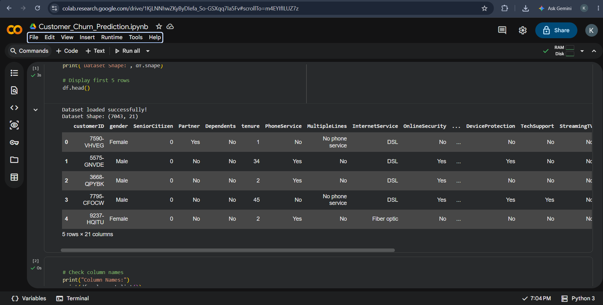

# Customer Churn Prediction Using Machine Learning 📊

## 📌 Project Overview
This project focuses on predicting customer churn using Python and Machine Learning. It analyzes customer data to identify patterns and predict whether customers are likely to leave a telecom company.

## 🎯 Objectives
- Analyze customer behavior and churn patterns.
- Clean and preprocess customer data.
- Perform Exploratory Data Analysis (EDA).
- Build and evaluate Machine Learning models.
- Identify important factors influencing customer churn.

## 📂 Dataset
**IBM Telco Customer Churn Dataset**

- Total records: 7,043 customers
- Target variable: Churn
- Features include customer details, services, tenure and billing information.

## 🛠️ Technologies Used
- Python
- Pandas
- NumPy
- Matplotlib
- Seaborn
- Scikit-learn
- Google Colab

## 🔍 Project Workflow
1. Data loading and exploration
2. Data cleaning and preprocessing
3. Exploratory Data Analysis
4. Data visualization
5. Train-test splitting
6. Machine Learning model training
7. Model evaluation
8. Feature importance analysis

## 🤖 Machine Learning Models
- Logistic Regression
- Decision Tree
- Random Forest

## 📈 Results
- Dataset size: 7,043 customers
- Customer churn: 1,869
- Customer retention: 5,174
- Random Forest accuracy: 78.96%

### Top Important Features
1. TotalCharges
2. Tenure
3. MonthlyCharges

## 📝 Conclusion
The project demonstrates how Machine Learning can help businesses identify customers who may leave and support customer retention strategies.

## 🚀 Future Improvements
- Improve churn detection using class balancing.
- Perform hyperparameter tuning.
- Test additional machine learning algorithms.
- Develop an interactive prediction dashboard.

## 👨‍💻 Author
**Kandula Karthik**

B.Tech CSE (Data Science) Student  
P P Savani University

[GitHub Profile](https://github.com/kandluakarthik-hash)  
[LinkedIn Profile](https://www.linkedin.com/in/kandula-karthik-b6b65b427/)

## 📸 Project Screenshots

### 1. Dataset Preview

### 2. Customer Churn Distribution

### 3. Customer Churn by Contract Type

### 4. Customer Churn by Tenure

### 5. Customer Churn by Monthly Charges

### 6. Model Accuracy Comparison

### 7. Random Forest Confusion Matrix

### 8. Feature Importance

